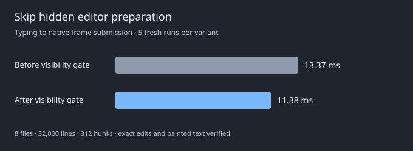

# Native Git interaction timings

The final fixture runs correctly, with no failed expansions, edits or disk-integrity checks. It measures one local workload, not physical input latency or performance parity with Zed.

The [paired follow-up](visible-layout/summary.json) isolates one final change: `actions.applyOutcome` now prepares normal source editors only when their pane displays an editor. Both variants already include retained Git buffers, local expansion, excerpt wrapping, background buffer diffs, and sticky headers. The baseline executable SHA matches the initial five-run record in this directory. This is not a before/after measurement of the whole delivery.



## Method

`tools/bench_git_interactions.zig` dispatches real Shell pointer and text input through the native UI, CoreText, layout, scene building and Metal submission. Each fresh process opens a disposable repository with eight 4,000-line files and 312 hunks, enables word wrap, reveals five lines four times, then types 24 characters into an added line. The exact document revision/bytes and submitted text are checked after every edit. The runner checks one source tab, all expansion/edit counts, zero errors, and unchanged disk hashes for every process. Initial repository loading is outside the timed region.

Expansion dispatch excludes the pointer-down frame. Expansion end-to-end includes both pointer-down and pointer-up frames. Typing end-to-end includes dispatch through frame submission, without waiting for unrelated background jobs. Lightweight phase timers are enabled in both variants. Measurements exclude physical event queuing, GPU completion and display scanout.

The paired run alternates variant order across five fresh processes per side. Every side performs 20 expansions and 120 verified edits overall. Both executables use `ReleaseFast`, identical fixture/settings and the same driver. The machine has eight logical cores; environment files record platform, load average, source hashes and executable digests. No build or native test suite ran during measurement.

## Results

For typing through frame submission, the median of run medians was 13.37 ms before the visibility gate, with a 13.19–13.45 ms range across run medians. It was 11.38 ms afterward, with an 11.16–11.59 ms range. Individual final edits ranged from 10.55 to 12.54 ms. The change removes about 2 ms of input-side CPU work; the frame's view construction remains about 4.3 ms, scene preparation about 0.46 ms and native presentation about 0.16 ms. Row layout is about 0.038 ms. These phases identify CPU input/view preparation as the remaining cost in this fixture; they do not isolate every editor helper.

Final expansion input dispatch had a 0.44 ms median of run medians, with a 0.42–0.46 ms range across run medians. The slowest individual dispatch was 1.36 ms. The complete two-frame click took about 16.6 ms. Expansion timing differences between the paired variants are within variation, as expected: the visibility gate changes typing work.

The original five-run record in this directory is retained because it exposed the unnecessary hidden-editor preparation. The authoritative final measurements and the isolated comparison are in `visible-layout/`.

## Reproduction

```sh
./tools/zig build build-bench-git -Doptimize=ReleaseFast
python3 tools/run_git_interactions.py --output /tmp/zircon-git-current --runs 5
```

To compare two optimized executables with the identical driver:

```sh
python3 tools/run_git_interactions.py --baseline-driver /path/to/baseline-driver --driver /path/to/current-driver --output /tmp/zircon-git-paired --runs 5
```

The follow-up baseline differs only in the two visibility conditions around normal-editor layout preparation in `actions.applyOutcome`. The original pre-delivery implementation was not benchmarked by this driver. Very large comparisons, long Unicode lines, cold glyph work and sustained native trackpad/input queues require separate workloads.
