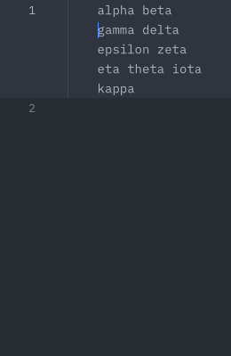
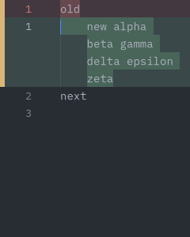

# Wrapping and gutter verification

Final checks run sequentially after the performance measurements:

- [Portable check](check.txt): passed, including all 45 editor checks and formatting.
- [Fresh native rendering chain](native-rendering.txt): all 92 passed. Includes three rendering regressions and the existing standalone/framework/application/settings chain.
- [Fresh real-clangd chain](real-clangd.txt): all 90 passed. This repeats the shared native chain and adds actual clangd acceptance; these are not 90 additional unique tests.
- [Release build/install](release-build.txt): passed. `zig-out/bin/zircon` includes the fixes. An already-running process needs restarting to load them.

Native render artifacts:

The [performance batch](../../../benchmarks/editor-2026-11-07/README.md) has its own raw results and six retained failures. Passing correctness tests do not make that service baseline pass.
