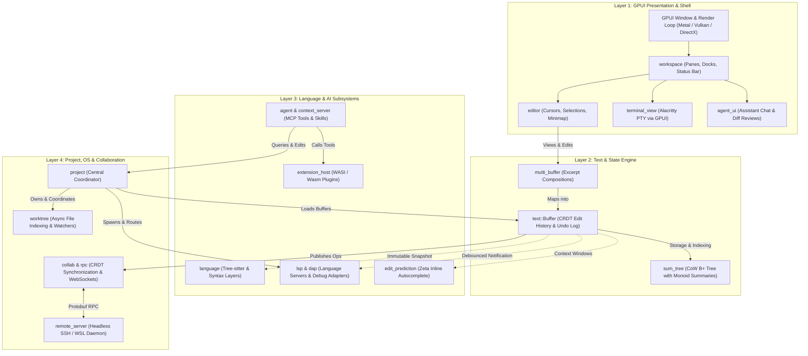

# Zed and Zircon architecture

Architecture discussion from November 15, 2026. The answers and HTML visuals are preserved. The editable Zircon flowchart quotes two edge labels for Mermaid compatibility.

[Zed and Zircon Architecture Export](t3-thread://v2/b79b85d5-1375-4bbb-b783-8d130943f509/e29a8e00-06c8-4228-84de-74a0b33c1b02)

## Zed architecture

**Question**

> I want you to check zed editor latest commit on main and tell me the architecutre and give me the diagram of how different things work together please

[Original visual: Zed Editor Architecture Diagram](diagrams/zed-architecture.html) · [Mermaid source](diagrams/zed-flowchart.mmd) · [Rendered flowchart](diagrams/zed-flowchart.svg)

### Latest Commit on `main`

- **Commit SHA**: [`596dfdcf32d85d4d8d17a8887b4d0979ec7c5e14`](https://github.com/zed-industries/zed/commit/596dfdcf32d85d4d8d17a8887b4d0979ec7c5e14)
- **Author**: Parker Loflin (`2026-11-15`)
- **Message**: `language: Reset max start depth on pooled query cursors (#66983)`
- **Scope**: Modifies `crates/language` to ensure pooled Tree-sitter `QueryCursorHandle` instances reset `max_start_depth` when dropped back to the pool, preventing depth-limited queries (like Vim motions `]m`, `]]`, `]/`) from accidentally truncating syntax highlighting queries.

---

### Core Architectural Philosophy

Zed is built around a single unifying principle: **zero-cost reactivity and thread safety via immutable data structures**.

Unlike Electron-based editors (which coordinate processes across an IPC bridge) or classical desktop IDEs (which rely on complex mutex locks around shared mutable buffers), Zed compiles into a single native Rust binary where:
1. The **UI Thread** runs a GPU-accelerated immediate/retained hybrid rendering loop targeting 120+ FPS.
2. Background worker pools perform syntax parsing, LSP queries, git operations, and AI generation against immutable, copy-on-write snapshots ([`SumTree`](https://github.com/zed-industries/zed/tree/main/crates/sum_tree)).
3. Modifications use operation-based CRDTs, ensuring multi-user collaboration and local edits share the exact same state update mechanics.

---

### Component Interaction Diagram



---

### How Key Subsystems Work Together

#### 1. GPUI (The GPU Framework)
- **Crates**: `gpui`, `gpui_platform`, `gpui_macros`, `gpui_tokio`
- GPUI bypasses web views entirely. It batches 2D rendering primitives (rectangles, shadows, glyphs from FreeType/DirectWrite/CoreText) directly into GPU command buffers (Metal on macOS, Vulkan on Linux, Direct3D on Windows).
- Uses an entity-based reactive model: [`Context<T>`](https://github.com/zed-industries/zed) coordinates state. When state changes, `cx.notify()` schedules a frame re-render without manual DOM diffing.

#### 2. SumTree & The Text Buffer Engine
- **Crates**: `sum_tree`, `rope`, `text`, `multi_buffer`
- At the center of Zed’s speed is `SumTree`, an immutable, copy-on-write B+ tree where each internal node stores summaries (monoids) such as byte length, UTF-16 count, and newline count.
- Because transformations take $O(\log N)$, operations like jumping to line 50,000, calculating visual 2D coordinates, or converting byte offsets are near-instantaneous.
- When an edit occurs, the buffer produces an operation record and an immutable snapshot. The main UI thread never blocks waiting for syntax parsing or search indexing.

#### 3. Language Intelligence & Tree-Sitter
- **Crates**: `language`, `lsp`, `dap`
- Zed parses syntax incrementally using Tree-sitter. As typing occurs, only modified AST branches are re-parsed.
- The `language` crate maintains layered grammar injections (e.g., SQL inside Rust string literals or JavaScript inside HTML) and handles cursor pooling to keep allocations at zero during fast navigation.
- The `lsp` crate runs language servers asynchronously over stdin/stdout, caching diagnostics and completion lists without stalling typing latency.

#### 4. Project, Worktree & File System
- **Crates**: `project`, `worktree`, `fs`, `git`
- `worktree` scans directory hierarchies asynchronously, filters ignores via `.gitignore`, and watches file events (`fsevents`, `inotify`).
- `project` binds worktrees to buffers, manages active LSP server instances per language, and handles Git repository status and hunk-level staging.

#### 5. Collaboration, Remote Development & CRDTs
- **Crates**: `collab`, `rpc`, `proto`, `remote`, `remote_server`
- Zed was architected from inception for collaborative editing. Buffer changes are expressed as CRDT operations with vector clocks (`clock`).
- Real-time sessions replicate operations over Protobuf-encoded RPC channels.
- Remote development uses `remote_server`—a lightweight headless daemon running on remote Linux or WSL instances that handles the filesystem, terminal, and language servers while streaming lightweight view data to the local GPUI client.

#### 6. AI Agent & Inline Next-Edit Prediction
- **Crates**: `agent`, `agent_servers`, `context_server`, `edit_prediction`, `language_models`
- Zed includes an autonomous Agent supporting the Model Context Protocol (MCP), enabling dynamic tool execution, web search, and codebase indexing.
- `edit_prediction` integrates models like Zeta for multi-token speculative code completions, evaluating context from recently active editor buffers and diff histories.

---

## Zircon architecture and comparison

**Question**

> now show me our zircon editor architecutre and then compare the two properly please

[Original visual: Zircon vs Zed Architecture Comparison](diagrams/zircon-vs-zed.html) · [Mermaid source](diagrams/zircon-flowchart.mmd) · [Rendered flowchart](diagrams/zircon-flowchart.svg)

### Zircon Editor Architecture

[Zircon](file:///Users/syedmuzamilm/work/expirements/zigpui/README.md) is an independent native desktop text editor and UI toolkit written in **Zig 0.17.1**. While GPUI and NanoUI served as architectural references, Zircon is built with zero C headers, zero Objective-C source files, and an entirely separate, contract-driven design.

```mermaid
flowchart TD
    subgraph UI ["zircon_ui (Native Zig UI Framework)"]
        AppKit["AppKit & Window Host (comptime objc_msgSend)"]
        Staging["Staging Frame Arena (Layout, Hitbox, Scene)"]
        SwapCommit["Transactional Swap & Rollback"]
        MetalPipeline["Metal Pipeline (1 Shader, 4 Modes, Glyph Atlas)"]
    end

    subgraph Shell ["Presentation & Canvas (Zig Packages)"]
        Workspace["zircon_workspace (Panes, Tabs, Splits)"]
        Editor["zircon_editor (Multi-cursor, Gutter, Selection)"]
        Widgets["zircon_widgets (Buttons, Inputs, Status Bar)"]
        Canvas["Canvas Leaf Element (Custom Drawing)"]
    end

    subgraph TextEngine ["Text & Buffer Layer"]
        Rope["zircon_text (AVL Rope, 4 KiB Leaves)"]
        History["Grouped Undo/Redo (Content State Identity)"]
        MultiBuf["zircon_multibuffer (Excerpt Compositions)"]
    end

    subgraph BackgroundServices ["Worker Processes & Services"]
        JobQueue["Job Queue (Entity-tied Workers + App.wake())"]
        ExtHost["zircon-extension-host (Out-of-Process Rust Worker)"]
        LSP["zircon_language (Stdio JSON-RPC Client)"]
        Git["zircon_git & zircon_git_ui (Status, Gutters, Blame)"]
    end

    %% Wiring
    AppKit --> Staging
    Staging -->|Success| SwapCommit --> MetalPipeline
    Staging -.->|Failure (Alloc/Layout)| Staging

    Workspace --> Editor & Widgets
    Editor --> Canvas
    Canvas --> MultiBuf --> Rope
    Rope --> History

    Editor -.->|Snapshots| LSP
    Editor -.->|Snapshots| Git
    ExtHost <-->|IPC| Workspace
    JobQueue -->|App.wake()| AppKit
```

---

### Key Zircon Subsystems

1. **[`zircon_ui`](file:///Users/syedmuzamilm/work/expirements/zigpui/packages/zircon_ui)**:
   - **Generational Entity Handles**: Application state is held in non-owning `Entity(T)` handles. Child entities are destroyed before parent entities, preventing dangling references.
   - **Const Render Law**: Views implement `pub fn render(self: *const Self, b: *ui.Ui) !ui.Element`. Attempting to mutate view state during a render pass is a compile-time failure.
   - **Double-Buffered Transactional Arenas**: A frame is built entirely within a staging arena (tree, flex layout, hitboxes, scene commands, IME snapshot). If any step fails (e.g., an allocation error), staging is dropped, and the last good frame remains committed.
   - **Direct Comptime macOS Seam**: System APIs (`AppKit`, `CoreText`, `Metal`, `ImageIO`, `NSTextInputClient`) are invoked via compile-time generated `objc_msgSend` bindings without `.m` or `.h` bridge files.
   - **Unified Metal Shader**: Renders four primitive types (analytic rounded rectangles, text glyphs, images, and round-capped lines) using 80-byte GPU instances and a 2048×2048 R8 grayscale glyph atlas.

2. **[`zircon_text`](file:///Users/syedmuzamilm/work/expirements/zigpui/packages/zircon_text) & [`zircon_multibuffer`](file:///Users/syedmuzamilm/work/expirements/zigpui/packages/zircon_multibuffer)**:
   - Uses an AVL rope backed by 4 KiB leaves.
   - Distinct separation between **revision counter** and **content-state identity**, guaranteeing that undoing back to the disk-saved state correctly resets the dirty flag.
   - Immutable, shared-node snapshots: background workers (Git, search, language servers) operate on retained immutable snapshots without locking the UI thread.

3. **[`zircon_extensions`](file:///Users/syedmuzamilm/work/expirements/zigpui/packages/zircon_extensions) & Out-of-Process Worker**:
   - Rather than embedding WASM inside the editor process, Zircon runs a dedicated out-of-process worker: [`zircon-extension-host`](file:///Users/syedmuzamilm/work/expirements/zigpui/tools) (in Rust).
   - The worker searches the official Zed extension catalog, downloads themes, icons, and grammars, and executes Tree-sitter parsers. If a grammar panics or corrupts memory, the editor stays alive.

---

### Detailed Side-by-Side Comparison: Zed vs. Zircon

| Dimension | **Zed** (`crates/*`) | **Zircon** (`packages/*`) | Architectural Takeaway |
| :--- | :--- | :--- | :--- |
| **Language & Ecosystem** | Rust (100+ crates, ~1,000,000+ SLoC). Heavy macro usage (`gpui_macros`, async traits). | Zig 0.17.1 (~30,000 SLoC across 13 packages). Minimal dependencies, comptime metaprogramming. | Zircon compiles in seconds and can be fully understood by a single engineer; Zed requires substantial build infrastructure. |
| **View Mutation Contract** | `render(&mut self, cx)` allows mutating internal view properties during render. | `render(self: *const Self, b)` strictly forbids mutation at compile-time. | **Zircon advantage**: Eliminates hidden side-effects and re-render loops during the display pass. |
| **State & Handle Ownership** | `Entity<T>` behaves like `Rc<RefCell<T>>`. Calling `entity.update()` leases `T` onto the stack; reentrant updates panic. | `Entity(T)` is a generational ID. Reads and updates are scoped (`app.read` / `app.update`). Returning pointers or slices is forbidden at comptime. | **Zircon advantage**: True memory safety without garbage collection or Rust borrow checker contortions around GUI graphs. |
| **Frame Rollback & Fault Tolerance** | Invalidation triggers tree rebuilds. Platform failures can leave the visual state inconsistent. | Two memory arenas: fallible staging arena + committed frame arena. If layout/alloc fails, staging is discarded without touching the screen. | **Zircon advantage**: Atomic UI transactions prevent partial or corrupted frames from reaching the display. |
| **Text Indexing & Rope Data Structure** | `SumTree` (Copy-on-Write B+ tree with monoid summaries) calculating line, byte, UTF-16, and 2D points in $O(\log N)$. | AVL rope with 4 KiB leaves. Line count and byte offsets are tracked, but soft-wrapping currently rescans visual rows. | **Zed advantage**: Zed scales cleanly to multi-gigabyte files and continuous 120 FPS soft-wrapping; Zircon experiences a wrap rebuild cliff on files $\ge$ 1 MiB. |
| **Layout System** | Full Taffy integration (Flexbox, CSS Grid, block layout, text-wrapping, child measurement). | Custom Zig flex subset (row, column, stack, grow/shrink with freezing). Custom elements are leaf nodes only (`no layoutChild`). | **Zed advantage**: Zed can easily build complex chrome, popovers, and nested dynamic lists. |
| **Platform Target** | Mature cross-platform abstractions: macOS (Metal/AppKit), Linux (Vulkan/X11/Wayland), Windows (Direct3D 11), iOS. | macOS-native first (`AppKit`, `CoreText`, `Metal`). Linux target exists solely for portable compilation of headless test suites. | **Zed advantage**: Broad multi-platform shipping coverage; Zircon focuses on macOS AppKit fidelity. |
| **Extension Isolation** | In-process WebAssembly / WASI engine executing language plugins, Tree-sitter parsers, and themes. | Out-of-process worker daemon (`zircon-extension-host`) written in Rust communicating over IPC pipes. | **Zircon advantage**: Fault isolation ensures third-party WASM code or Tree-sitter bugs cannot crash the editor. |
| **Multiplayer / Collaboration** | Built from the ground up for real-time multiplayer CRDTs, vector clocks (`clock`), and Protobuf RPC (`collab`). | Single-user local editor. No CRDT synchronization engine or peer-to-peer networking. | **Zed advantage**: Zed is designed as a collaborative IDE with integrated voice and remote SSH server capabilities. |
| **Accessibility (a11y)** | Integrated `AccessKit` tree, synthetic accessibility nodes for editor buffers, platform accessibility adapters. | Keyboard focus and Tab navigation. No OS accessibility tree exposure. | **Zed advantage**: Foundational infrastructure in place for screen readers and assistive tech. |

---

### Summary

- **Where Zircon excels**:
  1. **Strict correctness laws**: Compile-time const rendering, generational entity handles with compile-time snapshot validation, and double-buffered frame rollback guarantees that no corrupted frame ever displays.
  2. **Direct, clean OS integration**: System calls are generated directly via `objc_msgSend` without bridging layers or Objective-C stubs.
  3. **Fault isolation**: Parsing untrusted third-party code and grammars happens out-of-process via `zircon-extension-host`.

- **Where Zed leads**:
  1. **Algorithmic data structures**: `SumTree` provides $O(\log N)$ projections across byte offsets, visual wrapped rows, fold markers, and multi-buffer excerpts.
  2. **Industrial feature completeness**: Full cross-platform support (macOS, Windows, Linux), Tree-sitter query cursor pooling, real-time multiplayer CRDTs, integrated DAP debugging, and autonomous AI agents.
